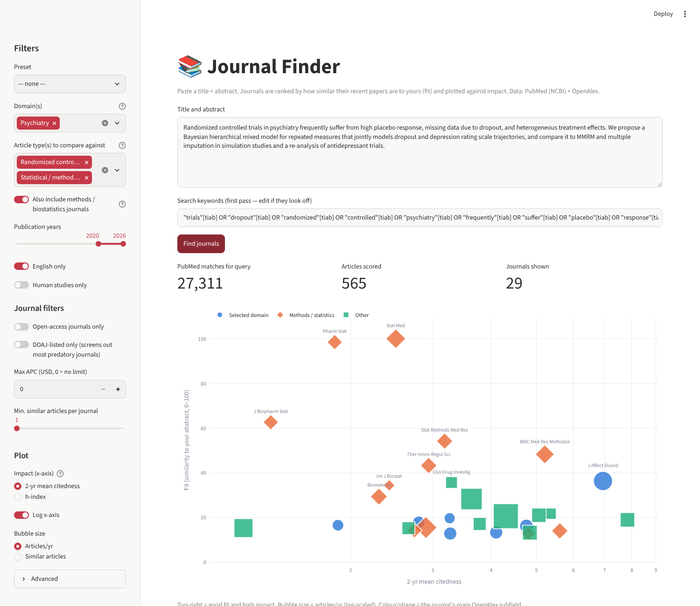

# 📚 Journal Finder

A JANE-style ([jane.biosemantics.org](https://jane.biosemantics.org/)) journal recommender with a
**fit × impact** scatter plot. Paste your title and abstract. The app finds the most similar recent
PubMed papers in the domains and article types you choose, then ranks journals by how well their
papers match yours. Each journal is plotted with:

| Axis | Meaning | Source |
|---|---|---|
| **y — Fit (0–100)** | Sum of TF-IDF cosine similarities of the journal's papers among the top-K most similar articles, scaled so the best journal = 100 | PubMed |
| **x — Impact** | 2-year mean citedness (free analogue of the Journal Impact Factor) or h-index | OpenAlex |
| **Bubble size** | Articles per year (3-yr mean) or # similar articles | OpenAlex / PubMed |
| **Colour + shape** | Journal's main subfield: in your domain / methods & statistics / other | OpenAlex |



## Run it locally

```bash
git clone https://github.com/<you>/journal-finder.git
cd journal-finder
python -m venv .venv && source .venv/bin/activate     # Windows: .venv\Scripts\activate
pip install -r requirements.txt
cp .streamlit/secrets.toml.example .streamlit/secrets.toml   # add your e-mail (optional API key)
streamlit run app.py
```

## Toggles

**Search scope (what papers your abstract is compared against)**

- **Domain(s)**: Cardiology, Cell & Molecular Neuroscience, Endocrinology & Diabetes, Immunology,
  Infectious Diseases, Neurology, Oncology, Psychiatry. These are broad MeSH filters, defined in
  `core.DOMAINS`.
- **Article type(s)** (combined with OR, using PubMed publication types):
  - Novel data (original research): journal articles, excluding reviews, meta-analyses, editorials, letters and comments
  - Randomized controlled trial
  - Clinical trial (any phase)
  - Observational study
  - Statistical / methods paper (statistics, research design and RCT-methodology MeSH)
  - Narrative review
  - Systematic review
  - Meta-analysis
  - Trial protocol
- **Also include methods / biostatistics journals**: adds stats-methods papers from outside your
  domain, so journals like *Statistics in Medicine*, *Trials* and *BMC Med Res Methodol* can appear.
- Publication-year range, English only, human studies only.

**Journal filters (applied after scoring)**: open-access only, DOAJ-listed only (a decent screen
against predatory journals), maximum APC in USD, and a minimum number of similar articles.

**Plot**: impact metric, log x-axis, bubble size metric.

**Presets**: for example, *Statistical RCT methods paper → psychiatry* sets Psychiatry + RCT +
Statistical/methods, with methods journals switched on.

Tip for a stats-methods paper aimed at psychiatry: compare the results with the
methods-journals switch **on** and **off**. With it on, you see where methodologists publish. With
it off, you see which psychiatry journals publish this kind of work (for example *J Affect Disord*,
*J Clin Psychiatry*, *J Clin Psychopharmacol*).

## How it works

1. A first PubMed query is built from your abstract's keywords + domain + type filters. Results are
   sorted by PubMed "Best Match".
2. **Two-pass refinement**: using those hits as a background corpus, the app picks the terms that are
   most *distinctive* in your abstract and searches again.
3. All candidate abstracts are scored by TF-IDF cosine similarity to yours. The top K (default 50)
   decide each journal's fit.
4. Journals are matched to OpenAlex by ISSN to get impact, volume, OA status and APC.

Code layout: `core.py` holds all the logic (no UI, so it can be used from a notebook or script),
and `app.py` holds the Streamlit UI.

## Put it on GitHub / online

```bash
git init && git add . && git commit -m "Journal Finder"
gh repo create journal-finder --public --source=. --push     # or create the repo on github.com and push
```

To get a free public web app, go to [share.streamlit.io](https://share.streamlit.io), choose
**New app**, pick the repo and set `app.py` as the main file. Paste `CONTACT_EMAIL` /
`NCBI_API_KEY` under *Settings → Secrets*. **Never commit `.streamlit/secrets.toml`**; it is
already in `.gitignore`.

## Data & licensing notes

- **PubMed / E-utilities**: free. Please supply an e-mail address. Limits are 3 requests/s without
  an API key and 10/s with one ([NCBI usage policy](https://www.ncbi.nlm.nih.gov/books/NBK25497/)).
- **OpenAlex**: CC0, free to use and redistribute.
- The official **Journal Impact Factor** (Clarivate) is proprietary, so don't scrape it or commit it
  to a public repo. That is why this app uses OpenAlex's 2-yr mean citedness. It follows a similar
  idea but the numbers are not identical.

## Limitations

- Fit is lexical (TF-IDF), not semantic. Edit the first-pass keywords if they look off.
  Sentence-embedding models (for example `sentence-transformers`) would be the natural upgrade.
- A journal's fit depends on how many similar papers it published, so high-volume journals get a
  boost (JANE has the same effect). Use the "Similar articles" column to judge this.
- "Main subfield" is OpenAlex's topic classification and is occasionally odd for broad journals.
